# 奶蛙桌宠 naiwa-pet

一只住在 Mac 桌面角落、跟着 Claude Code 干活的奶蛙。空闲时它按一天的时段换一只，在那里慢慢地动；Claude 一开工，还是这只陪着你干；Claude 要你批准时，它头顶冒个气泡，用自己的方式叫你（瞟你一眼、举起小手、侧身听着）；活干完了、你点它摸它，它按自己的样子回你一下——沉溺奶蛙是镜头推近、斜着瞥你一眼，惊鸿一瞥。

原生 Swift，没有声音，不抢焦点，不花 token。

[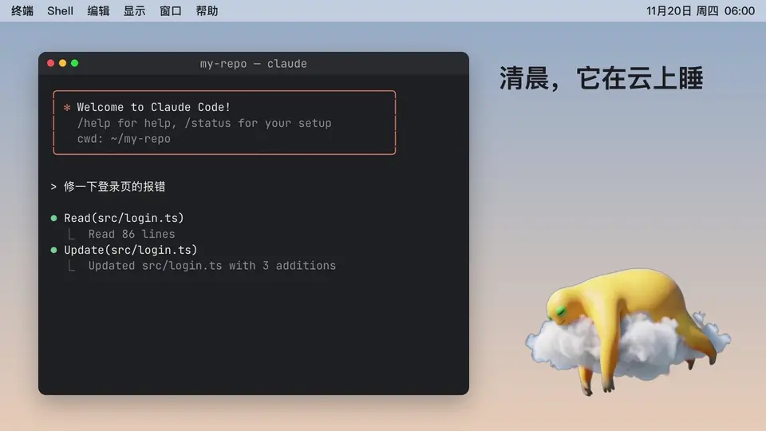](#视频介绍)

## 视频介绍

https://github.com/user-attachments/assets/3b57d454-f4c0-4b1f-8327-81961681a8f9

## 所有奶蛙

每一只都会动。默认安排里用到的：

<table>
<tr>
<td align="center"><br><b>安睡</b> <code>sleep</code><br>早上 6 点起</td>
<td align="center"><br><b>听歌</b> <code>listen</code><br>中午 12 点起，和悠闲轮流</td>
<td align="center"><br><b>悠闲</b> <code>relax</code><br>中午 12 点起，和听歌轮流</td>
</tr>
<tr>
<td align="center"><br><b>云幻</b> <code>cloud</code><br>傍晚 5 点起</td>
<td align="center">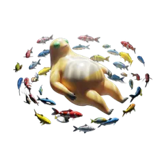<br><b>封闭</b> <code>fish</code><br>晚上 8 点起</td>
<td align="center"><br><b>孤独</b> <code>lonely</code><br>0 点以后</td>
</tr>
<tr>
<td align="center"><br><b>沉溺</b> <code>immerse</code><br>想让干活时固定是它，右键选它</td>
<td align="center"><br><b>沉溺 · 看着你</b><br>Claude 等你批准时</td>
<td align="center"><br><b>惊鸿一瞥</b><br>干完一个活、点它摸它时</td>
</tr>
</table>

还能挑这些，右键勾上就会出来（比如干活时换成被数据线缠住的那只）：

<table>
<tr>
<td align="center">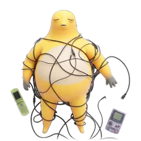<br><b>缠线</b> <code>wires</code></td>
<td align="center">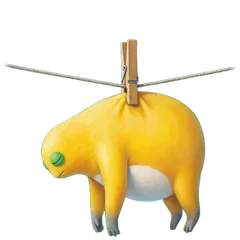<br><b>晾衣</b> <code>clothespin</code></td>
<td align="center">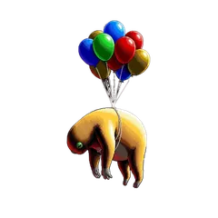<br><b>气球</b> <code>balloons</code></td>
</tr>
<tr>
<td align="center"><br><b>漂浮</b> <code>float</code></td>
<td align="center"><br><b>花海</b> <code>flowers</code></td>
<td align="center"><br><b>涟漪</b> <code>ripple</code></td>
</tr>
</table>

| 什么时候 | 奶蛙 |
|---|---|
| 空闲 | 按时段换（见上面），同一时段有几只就轮流出来 |
| Claude 在干活 | 还是空闲时那只，干完这一轮才换；右键「干活时」可以固定成某一只（比如沉溺） |
| Claude 等你批准（要权限、MCP 弹窗问你） | 头顶「my-repo 等你批准 Bash」，它用自己的方式叫你（见下表）；你处理完它接着干 |
| 干完一个活（这一轮跑满 1 分钟，且读写过文件或跑过命令） | 它回你一下（见下面），头顶「my-repo 做完了 · 4 分 12 秒」 |
| 只聊了几句 / 说完话没理它 | 不打扰 |
| 你点它、摸它 | 也回你一下 |

13 只都有自己的样子，和它待的地方有关：

<table>
<tr><th>奶蛙</th><th>等你批准时</th><th>做完、点它摸它</th></tr>
<tr>
<td align="center"><b>安睡</b> <code>sleep</code></td>
<td align="center"><br>看着你</td>
<td align="center"><br>蹭一蹭</td>
</tr>
<tr>
<td align="center"><b>听歌</b> <code>listen</code></td>
<td align="center"><br>侧耳</td>
<td align="center"><br>点点头</td>
</tr>
<tr>
<td align="center"><b>悠闲</b> <code>relax</code></td>
<td align="center"><br>举手</td>
<td align="center"><br>伸懒腰</td>
</tr>
<tr>
<td align="center"><b>云幻</b> <code>cloud</code></td>
<td align="center"><br>看着你</td>
<td align="center"><br>深呼吸</td>
</tr>
<tr>
<td align="center"><b>封闭</b> <code>fish</code></td>
<td align="center">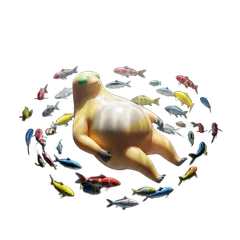<br>看着你</td>
<td align="center">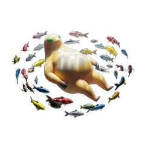<br>小鱼游近</td>
</tr>
<tr>
<td align="center"><b>孤独</b> <code>lonely</code></td>
<td align="center"><br>侧身听</td>
<td align="center"><br>晃一晃</td>
</tr>
<tr>
<td align="center"><b>缠线</b> <code>wires</code></td>
<td align="center">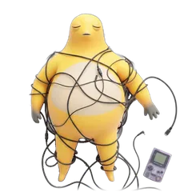<br>举手</td>
<td align="center">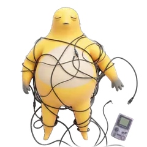<br>扭一扭</td>
</tr>
<tr>
<td align="center"><b>晾衣</b> <code>clothespin</code></td>
<td align="center">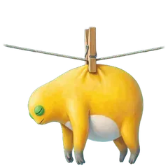<br>看着你</td>
<td align="center">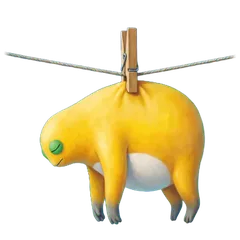<br>扑腾</td>
</tr>
<tr>
<td align="center"><b>气球</b> <code>balloons</code></td>
<td align="center"><br>看着你</td>
<td align="center"><br>飘一下</td>
</tr>
<tr>
<td align="center"><b>漂浮</b> <code>float</code></td>
<td align="center">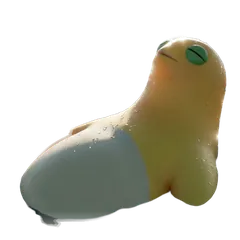<br>看着你</td>
<td align="center">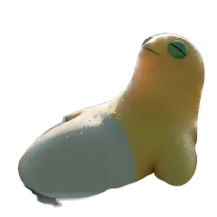<br>浪来了</td>
</tr>
<tr>
<td align="center"><b>花海</b> <code>flowers</code></td>
<td align="center"><br>迎风</td>
<td align="center">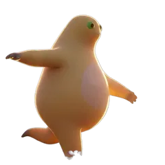<br>乘风</td>
</tr>
<tr>
<td align="center"><b>涟漪</b> <code>ripple</code></td>
<td align="center"><br>看着你</td>
<td align="center"><br>落花</td>
</tr>
<tr>
<td align="center"><b>沉溺</b> <code>immerse</code></td>
<td align="center"><br>看着你</td>
<td align="center"><br>惊鸿一瞥</td>
</tr>
</table>

## 特色

- **好看**：13 只奶蛙，每一只都会动，透明背景，放在浅色、深色桌面上都干净。
- **跟着时间换，也能自己挑**：默认早上、中午、傍晚、晚上、深夜各是不同的一只；每个时段出来哪几只、干活时是哪只，右键就能换，见下面「换成你喜欢的」。
- **小**：原生 Swift + AppKit，没有 Electron、没有第三方依赖。播放时约 3–4% CPU、十几 MB 内存；只在看得见的时候播，被别的窗口挡住、锁屏、屏幕睡了就停。
- **懂 Claude Code**：给每个会话单独记账，只有真干完一个活才有反应，聊两句不打扰；同时开好几个会话，气泡会标出是哪个项目。判断全在本地，不调模型、不花 token，每次钩子约 5 毫秒。
- **不打扰**：没有声音，没有 Dock 图标，点它不会抢走焦点，透明的地方鼠标直接穿过去，不挡你点后面的窗口。
- **只动它该动的配置**：接入 Claude Code 时只往 `settings.json` 里插几条，写之前逐字段核对其他内容完全不变，一条命令就能撤掉。

## 安装

需要 macOS 13 及以上。

**下载通用安装包**：从 [Releases](https://github.com/nwverse/naiwa-pet/releases/latest) 下载 ZIP，解压后把 `Naiwa.app` 放进 `~/Applications` 并打开，同时支持 Apple 芯片和 Intel。升级时先退出旧版再替换 App；旧版用户更新后重新运行一次 `naiwa hooks install`。没有命令行链接时，用 `~/Applications/Naiwa.app/Contents/MacOS/naiwa hooks install` 接入。

下载包使用 ad-hoc 签名，尚未经过 Developer ID 签名或 Apple 公证，首次打开可能被 macOS 拦截。

**从源码安装**：需要 Command Line Tools（没装的话运行 `xcode-select --install`），不需要 Xcode。以下脚本会配置命令行和登录自启：

```bash
git clone https://github.com/nwverse/naiwa-pet.git
cd naiwa-pet
scripts/install.sh       # 编译并装好：~/Applications/Naiwa.app，命令 ~/.local/bin/naiwa，登录时自动出现
naiwa hooks install      # 接入 Claude Code
naiwa demo               # 演示一遍所有样子
```

- 奶蛙默认待在屏幕右下角、Dock 上方，拖动可以换位置，它会记住。
- 如果提示 `~/.local/bin` 不在 PATH 里，按提示把那一行加进 `~/.zshrc`。
- 接入后对新的 Claude Code 会话生效；已经开着的会话一般也会马上生效，没反应就重开一下。
- 是从源码本地编译的，不经过下载，所以不会被 macOS 的「无法验证开发者」拦住。

卸载：`scripts/uninstall.sh`。它会撤掉 Claude Code 接入、关掉奶蛙，并删掉 App、命令、登录自启、偏好设置和 `~/.config/naiwa/config.json`。

## 用法

| 操作 | 效果 |
|---|---|
| 鼠标在它身上停一下（空闲时） | 换下一只，头顶报名字；到下个时段回到你的安排 |
| 点一下，或者在它身上来回蹭几下 | 回你一下（每只不一样） |
| 拖动 | 换位置 |
| 右键 | 瞥你一眼 / 大小 / 空闲时（每个时段出来哪几只）/ 干活时（跟着时段，或固定一只）/ 让它走 |
| `naiwa demo` | 演示：空闲 → 干活 → 等你批准 → 干完回你一下 |
| `naiwa glance` | 让台上那只回你一下（旧名 `naiwa laugh` 也能用） |
| `naiwa pets` | 有哪几只奶蛙、现在哪个时段出来哪几只 |
| `naiwa` | 把它叫出来（右键「让它走」之后，`naiwa glance` 不会再把它叫回来） |
| `naiwa quit` | 关掉 |
| `naiwa hooks install` / `uninstall` | 接入 / 撤掉 Claude Code |

改「干完一个活」的门槛（默认 60 秒）：

```bash
defaults write com.nwverse.naiwa bigSeconds -float 30
```

## 换成你喜欢的

默认安排只是一种口味，可以自己换：

- **鼠标停一下**：空闲时把鼠标在它身上停一下就换下一只，13 只轮着看，挑到喜欢的再去右键里勾上。只管到这个时段结束。
- **右键 →「空闲时」**：每个时段一行，点进去勾上 / 去掉奶蛙。一个时段勾了几只，每干完一轮回到空闲轮流出来一只；至少留一只。
- **右键 →「干活时」**：默认「跟着时段」，空闲时是哪只，干活、等你、做完就还是哪只；也可以固定成某一只，比如一直用沉溺奶蛙。
- **改时段的起止时间**：右键 →「空闲时」→「改时段的起止时间…」，会打开 `~/.config/naiwa/config.json`，改完保存就生效，不用重启：

```json
{
  "idle": [
    {"from": 0, "pets": ["lonely"]},
    {"from": 6, "pets": ["sleep"]},
    {"from": 12, "pets": ["listen", "relax"]},
    {"from": 17, "pets": ["cloud"]},
    {"from": 20, "pets": ["fish"]}
  ],
  "work": "slot"
}
```

`from` 是这个时段从几点开始（0–23），到下一个时段的 `from` 为止；时段可以加、可以删。`work` 写 `slot` 是跟着时段，写某只的名字就固定是它。`pets` 里填的名字用 `naiwa pets` 查（也就是上面动图下面的英文名）。写错的名字、写坏的时段会被忽略，用回默认。保存后会自动重读，空闲时也会生效。文件暂时写坏时保留最近一次有效安排，菜单不会覆盖损坏的 JSON；当前版本不认识的名字、时段和其他字段会保留。菜单打开以后文件又有修改，也会以最新内容为准，只改你选中的那一项。这个文件可以直接发给别人用。不想要了：右键 →「空闲时」→「恢复默认」，或者删掉这个文件。

## 和 Claude Code 怎么对上的

`naiwa hooks install` 在 `~/.claude/settings.json` 的八个事件里各加一条 `naiwa hook`，每次触发时把事件转给奶蛙：

| 事件 | 奶蛙记下什么 |
|---|---|
| `UserPromptSubmit` | 这一轮开始了，开始计时 |
| `PreToolUse` / `PostToolUse` | 按 `tool_use_id` 和 `tool_name` 记录工具开始和完成，只清除匹配的权限等待；新工具开始时，如果所有未完成工具都在等批准，就清掉这些等待 |
| `PostToolUseFailure` | 工具失败了，还在干；`is_interrupt` 为真多半是你在工具跑着时按 Esc 打断了；没有其他工具在跑时，这一轮结束，不瞥 |
| `Notification` | 看 `notification_type`：`permission_prompt`、`elicitation_dialog`、`agent_needs_input` 算「等你」；`idle_prompt`（说完 60 秒你没理它）等其他提醒不算 |
| `Stop` | 这一轮结束：跑满门槛并且动过工具就瞥你一眼，否则什么都不做。别的 Stop hook 拦下来让它接着干（`stop_hook_active`）时算同一轮：时长从头算，一轮最多瞥一次 |
| `StopFailure` | API 出错（限流、认证失败之类）结束了这一轮：回到空闲，不瞥 |
| `SessionEnd` | 会话关了，不再记它 |

老版本装的只有六个事件，更新后重新跑一次 `naiwa hooks install`，补上 `PostToolUseFailure` 和 `StopFailure`。未收到完成事件的工具最长保留 6 小时；没有未完成工具的会话，半小时没动静后回到空闲。

权限通知通常没有 `tool_use_id`。恰好一个工具未完成时归给它；多个工具并行时，如果消息提到的工具名只匹配一个未完成工具，就归给它，否则保留为未分配的等待（同名的并行 Bash 也属于这种情况）。未分配的等待在所有工具完成、本轮结束或新消息后清除；权限提醒另有下面的 60 秒显示上限。超时由单次定时器触发，不依赖新事件。

权限提醒最多显示 60 秒，之后恢复「干活」（没有正在进行的会话则回到空闲），工具结束时仍按实际时长决定是否瞥你。批准本身没有 hook 事件，所以这只是显示策略：即使你还没批准，60 秒后也会停止提醒；不会代替你批准或改变 Claude 的权限。MCP 表单和「等你回复」不受这个 60 秒上限影响。

已知局限：在权限确认框上按 Esc，或者没有工具在跑时按 Esc，都可能没有事件。工具完成、本轮结束、新消息或会话超时后才会清掉相应状态。超过 6 小时的工具会被放弃，结束时可能没有反应。Claude 中途停下来等后台任务、或者停下来问你问题，从事件上看和「做完了」一样，只要时长够、动过工具也会有反应。

**Codex**：只能接 `notify`，它只在一轮结束时通知，所以只能做到「做完瞥一眼」，没有干活、等你这些状态。在 `~/.codex/config.toml` 最上面加 `notify = ["/Users/你/.local/bin/naiwa", "glance"]`。Codex 只认一个 notify，已经有的话要自己串起来。

**其他命令行**：长任务后面接一句就行，比如 `make build; naiwa glance`。

## 许可证

[MIT](LICENSE)

## 开发

### PR 检查与自动合并

PR 会运行 `macOS checks`：检查脚本语法和素材配置 JSON，运行回归测试，编译 Apple 芯片与 Intel 版本，打包通用 App，并验证架构、签名和 `pets` 命令。

维护者给面向 `main` 的非草稿 PR 加上 `automerge` 标签后，会开启自动 squash 合并。必须通过检查、与最新 `main` 同步，并解决所有 review 对话，才会合入；分支落后时先点 **Update branch**，更新后会重新检查。首次贡献者的工作流可能需要维护者先批准运行。

移除 `automerge` 标签、转为草稿或改投其他分支，会取消等待中的自动合并。不加标签的 PR 仍由维护者手动合并。CI 不验证桌面上的播放、锁屏停播和鼠标穿透；相关改动仍须按 `AGENTS.md` 在真机确认，再加标签。

### 发布版本

先通过 PR 更新 `VERSION` 和对应的 `docs/releases/v版本号.md`，合入 `main` 后，在该提交上推送同名 `v版本号` 标签。`Release` 工作流会核对标签、版本和主分支来源，运行回归测试、构建并验证通用 App，再发布 ZIP 和 `SHA256SUMS.txt`。只有附件上传完整后才公开 Release；已有 Release 不会被自动覆盖。

### 本地构建

```bash
swift build -c release
NAIWA_ASSETS=$PWD/assets .build/release/naiwa      # 直接跑，不用打包
scripts/build_app.sh                               # 打包 build/Naiwa.app（Intel + Apple 芯片通用）
```

代码在 `Sources/naiwa/`：

- `Pet.swift`：窗口、状态机（瞥 > 等你 > 干活 > 空闲）、按时段换空闲的奶蛙、悬停换只、看不见时停播、鼠标交互
- `Schedule.swift`：用户自己的安排（`~/.config/naiwa/config.json`）：哪个时段出来哪几只、干活时是哪只
- `Sessions.swift`：按钩子事件给每个会话记账，判断状态和这一轮算不算干完
- `Assets.swift`：读素材（有哪几只、默认安排），播放片段（系统硬件解码，解码出来的帧直接交给图层，不复制）
- `Bubble.swift`：头顶气泡
- `Link.swift`：命令行和桌宠之间的通道（具名 CFMessagePort，顺带保证只有一只），以及 `naiwa hook` / `demo` / `pets` 和偏好设置
- `Hooks.swift`：`naiwa hooks install / uninstall`

素材在 `assets/`：每只奶蛙一段带透明通道的 HEVC，`assets.json` 记着有哪几只和默认安排。
